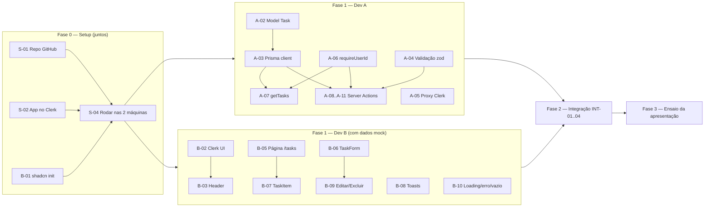
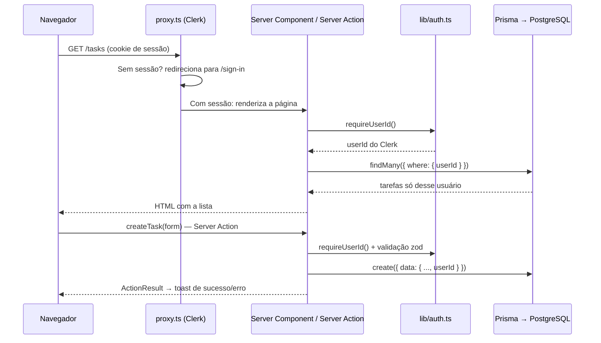

# Gerenciador de Tarefas — IFMA Campus Timon

Projeto em dupla da disciplina **Fundamentos de Desenvolvimento WEB** (Prof. Me. Abílio Soares Coelho).

Aplicação web onde cada usuário cria sua conta, faz login e gerencia **apenas as próprias tarefas**.

**Stack:** Next.js 16 (App Router + TypeScript) · Clerk 7 (autenticação) · Prisma 7 (ORM) · PostgreSQL 17 (Docker) · shadcn/ui + Tailwind 4 · zod + react-hook-form

> ⚠️ **Este repositório é só o esqueleto (scaffold).** As pastas, os arquivos e os contratos entre front e back já existem, mas nenhuma funcionalidade está implementada. Cada arquivo tem comentários `TODO [ID]` dizendo o que fazer, e os IDs batem com a tabela de tarefas abaixo.
> Para achar suas tarefas no código: pesquise por `TODO [A-` ou `TODO [B-` no VS Code (Ctrl+Shift+F).

---

## Sumário

1. [Quem faz o quê](#1-quem-faz-o-quê)
2. [Ordem de trabalho](#2-ordem-de-trabalho)
3. [Tarefas detalhadas](#3-tarefas-detalhadas)
4. [Como executar](#4-como-executar)
5. [Estrutura de pastas](#5-estrutura-de-pastas)
6. [Fluxo de Git](#6-fluxo-de-git)
7. [Roteiro da apresentação](#7-roteiro-da-apresentação)
8. [Atenção às versões](#8-atenção-às-versões)
9. [Problemas comuns](#9-problemas-comuns)

---

## 1. Quem faz o quê

A divisão é por **camada**: um cuida do servidor e dos dados, o outro da interface. Os dois trabalham em paralelo desde o primeiro dia porque o "meio de campo" (tipos, schema de validação e assinaturas das Server Actions) já está definido no scaffold.

| | **Dev A — Back-end & Dados** | **Dev B — Front-end & Interface** |
|---|---|---|
| **Nome** | _preencher_ | _preencher_ |
| **Cuida de** | Docker/PostgreSQL, Prisma, proteção de rotas e de dados, Server Actions, validação no servidor | shadcn/ui, telas do Clerk, layout, listagem, formulários, diálogos, toasts, responsividade |
| **Requisitos do PDF** | 1 (parte servidor), 3 (consulta), 4/5 (lógica), **7**, **8**, 9 (servidor) | 1 (telas), 2/3/4/5 (interface), **6**, 9 (cliente + mensagens) |
| **Arquivos principais** | `prisma/`, `src/proxy.ts`, `src/lib/prisma.ts`, `src/lib/auth.ts`, `src/lib/validations/`, `src/server/` | `src/app/`, `src/components/` |

**Arquivos de contrato** (os dois usam; mudança só combinando antes):
`src/types/task.ts` · `src/types/action-result.ts` · `src/lib/validations/task.ts` · assinaturas em `src/server/tasks/actions.ts`

> 💡 O PDF pede que **cada dupla explique a integração Next.js + Clerk + Prisma + PostgreSQL**. Por isso, revisem o PR um do outro: quem fez o front precisa entender o back e vice-versa.

---

## 2. Ordem de trabalho



| Fase | O que acontece | Pronto quando |
|---|---|---|
| **0 — Setup** | Repositório, Clerk, shadcn e ambiente rodando nas duas máquinas | Os dois abrem `http://localhost:3000` e o banco sobe com `npm run db:up` |
| **1 — Paralelo** | A faz o back-end; B faz as telas usando `src/lib/mock-tasks.ts` | A: actions funcionam (testar com Prisma Studio). B: telas completas com dados falsos |
| **2 — Integração** | Trocar o mock pelas actions/queries reais | CRUD completo funcionando com login real |
| **3 — Testes e ensaio** | Teste com duas contas, polimento, ensaio | Checklist da [seção 7](#7-roteiro-da-apresentação) todo marcado |

---

## 3. Tarefas detalhadas

Marque `[x]` conforme for terminando (dá para editar este README pelo próprio GitHub).

### Fase 0 — Setup

| ✓ | ID | Responsável | Tarefa |
|---|---|---|---|
| [ ] | S-01 | **A** | Criar o repositório no GitHub, subir este scaffold, convidar o colega como colaborador e proteger a branch `main` (exigir PR). |
| [ ] | S-02 | **A** | Criar a aplicação no [dashboard do Clerk](https://dashboard.clerk.com) (login por e-mail; Google opcional) e passar as chaves para o colega **por mensagem privada** (nunca no git). Os dois usam o mesmo app do Clerk. |
| [ ] | B-01 | **B** | Inicializar o shadcn/ui e instalar os componentes (comandos abaixo). Fazer commit e avisar o A para dar `git pull`. |
| [ ] | S-04 | **Ambos** | Seguir a [seção 4](#4-como-executar) e confirmar que o projeto roda nas duas máquinas. |

Comandos do **B-01** (rodar na raiz do projeto):

```bash
npx shadcn@latest init
npx shadcn@latest add button card input textarea label field checkbox badge dialog alert-dialog sonner skeleton empty tabs dropdown-menu
```

> O `init` vai sobrescrever `src/app/globals.css` e criar `src/lib/utils.ts` e `components.json` — isso é esperado.

### Fase 1 — Dev A (Back-end & Dados)

| ✓ | ID | Tarefa | Arquivo(s) | Req. | Depende de |
|---|---|---|---|---|---|
| [ ] | A-01 | Subir o PostgreSQL pelo Docker, conferir o `DATABASE_URL` e ajudar o B a subir também | `docker-compose.yml`, `.env` | 7 | S-04 |
| [ ] | A-02 | Criar o `model Task` (campos no comentário do arquivo), rodar `npm run db:migrate -- --name init` e trocar o tipo manual pelo do Prisma | `prisma/schema.prisma`, `src/types/task.ts` | 7, 8 | A-01 |
| [ ] | A-03 | Cliente Prisma único com o adapter `@prisma/adapter-pg` | `src/lib/prisma.ts` | 7 | A-02 |
| [ ] | A-04 | Regras e mensagens em português no schema zod (título obrigatório, limites, trim) | `src/lib/validations/task.ts` | 9 | — |
| [ ] | A-05 | Proteger as rotas com `clerkMiddleware` (públicas: `/`, `/sign-in`, `/sign-up`) | `src/proxy.ts` | 1, 8 | S-02 |
| [ ] | A-06 | `requireUserId()` usando `auth()` do Clerk | `src/lib/auth.ts` | 8 | S-02 |
| [ ] | A-07 | `getTasks()`: só tarefas do usuário logado, ordenadas por `createdAt` | `src/server/tasks/queries.ts` | 3, 8 | A-03, A-06 |
| [ ] | A-08 | Server Action `createTask` | `src/server/tasks/actions.ts` | 2, 8, 9 | A-03, A-04, A-06 |
| [ ] | A-09 | Server Action `updateTask` (filtrando por `id` **e** `userId`) | `src/server/tasks/actions.ts` | 5, 8, 9 | A-08 |
| [ ] | A-10 | Server Action `setTaskCompleted` (concluir / reabrir) | `src/server/tasks/actions.ts` | 4, 8 | A-08 |
| [ ] | A-11 | Server Action `deleteTask` | `src/server/tasks/actions.ts` | 5, 8 | A-08 |
| [ ] | A-12 | *(opcional)* Script de seed com tarefas de exemplo para a demonstração | `prisma/seed.ts` | — | A-03 |

O comentário no topo de `actions.ts` descreve o **padrão que toda action deve seguir** (pegar o usuário no servidor → validar com zod → filtrar por `userId` → `revalidatePath` → devolver `ActionResult`).

### Fase 1 — Dev B (Front-end & Interface)

| ✓ | ID | Tarefa | Arquivo(s) | Req. | Depende de |
|---|---|---|---|---|---|
| [ ] | B-02 | `ClerkProvider` (com `ptBR` de `@clerk/localizations`) e páginas de login e cadastro | `src/app/layout.tsx`, `src/app/sign-in/…`, `src/app/sign-up/…` | 1 | S-02 |
| [ ] | B-03 | Cabeçalho com `UserButton` (logout) para logado e botões Entrar/Criar conta para visitante | `src/components/layout/header.tsx` | 1, 6 | B-02 |
| [ ] | B-04 | Página inicial pública (redireciona para `/tasks` se já estiver logado) | `src/app/page.tsx` | 6 | B-02 |
| [ ] | B-05 | Página `/tasks` + `TaskList` usando `mockTasks`, com contador de pendentes/concluídas | `src/app/tasks/page.tsx`, `src/components/tasks/task-list.tsx` | 3, 6 | B-01 |
| [ ] | B-06 | `TaskForm` (criar/editar) com react-hook-form + zod, erro embaixo de cada campo | `src/components/tasks/task-form.tsx` | 2, 9 | B-01 |
| [ ] | B-07 | `TaskItem`: card com checkbox, título riscado se concluída, badge, data em pt-BR | `src/components/tasks/task-item.tsx` | 4, 6 | B-05 |
| [ ] | B-08 | `Toaster` (sonner) no layout e padrão de mensagens de sucesso/erro | `src/app/layout.tsx` | 9 | B-01 |
| [ ] | B-09 | Diálogo de edição e confirmação de exclusão | `edit-task-dialog.tsx`, `delete-task-dialog.tsx` | 5 | B-06 |
| [ ] | B-10 | Estados de carregamento (skeleton), erro e lista vazia | `src/app/tasks/loading.tsx`, `error.tsx`, `empty-state.tsx` | 6 | B-05 |
| [ ] | B-11 | Revisão de responsividade (celular 360px, tablet, desktop) e acessibilidade (labels, foco, contraste) | todos de `src/components/` | 6 | B-07, B-09 |

### Fase 2 — Integração

| ✓ | ID | Responsável | Tarefa |
|---|---|---|---|
| [ ] | INT-01 | **A** | Em `src/app/tasks/page.tsx`, trocar `mockTasks` por `await getTasks()` e apagar `src/lib/mock-tasks.ts`. |
| [ ] | INT-02 | **B** | `TaskForm` chamando `createTask` / `updateTask`, com toast e `form.setError()` para os `fieldErrors` do servidor. |
| [ ] | INT-03 | **B** | Checkbox chamando `setTaskCompleted` e botão excluir chamando `deleteTask` (com toasts). |
| [ ] | INT-04 | **A** | **Teste de segurança** com duas contas (roteiro abaixo) e correção do que falhar. |

**Roteiro do INT-04** (guardem prints — é ótimo para a apresentação):

1. Conta 1 cria 2 tarefas. Conta 2 (outra aba anônima) não deve ver nenhuma delas.
2. Copie o `id` de uma tarefa da conta 1 (pelo Prisma Studio) e, logado como conta 2, tente editar/excluir esse `id` (ex.: alterando temporariamente o id no código do cliente). A action deve responder "Tarefa não encontrada" e nada muda no banco.
3. Deslogado, acessar `http://localhost:3000/tasks` deve mandar para o login.
4. Enviar o formulário com título vazio deve mostrar erro no campo (cliente) — e, se a validação do cliente for burlada, o servidor também recusa.

---

## 4. Como executar

### Pré-requisitos

- [Node.js](https://nodejs.org) **22 LTS** (mínimo 20.9)
- [Docker Desktop](https://www.docker.com/products/docker-desktop/) (para o PostgreSQL)
- [Git](https://git-scm.com)
- Conta no [Clerk](https://clerk.com) (gratuita) — ou as chaves que o colega passou (S-02)

### Passo a passo

```bash
# 1. Clonar e entrar na pasta
git clone <url-do-repositorio>
cd todo-list

# 2. Criar o .env a partir do exemplo e preencher as chaves do Clerk
cp .env.example .env          # no Windows (PowerShell/CMD): copy .env.example .env

# 3. Instalar as dependências (também roda `prisma generate`)
npm install

# 4. Subir o PostgreSQL no Docker
npm run db:up

# 5. Criar/atualizar as tabelas (só depois que o A-02 estiver no repositório)
npm run db:migrate

# 6. Rodar o app em modo desenvolvimento
npm run dev
```

Abra **http://localhost:3000**.

### Comandos úteis

| Comando | O que faz |
|---|---|
| `npm run dev` | Inicia o Next.js em modo desenvolvimento |
| `npm run db:up` / `npm run db:down` | Sobe / derruba o container do PostgreSQL (os dados ficam salvos no volume) |
| `npm run db:migrate` | Cria uma migration a partir do `schema.prisma` e aplica no banco |
| `npm run db:studio` | Abre o Prisma Studio para ver/editar os dados no navegador |
| `npm run db:reset` | Apaga tudo e recria o banco do zero (cuidado!) |
| `npm run db:generate` | Regenera o cliente do Prisma (depois de mudar o schema) |
| `npm run lint` | Verifica o código com ESLint |
| `npm run typecheck` | Verifica os tipos do TypeScript |
| `npm run build` | Gera o build de produção (rodar antes de abrir PR é uma boa ideia) |

### Rodando tudo no Docker (opcional — bom para testar antes da apresentação)

Sobe o banco, aplica as migrations e roda o app em modo produção, tudo em containers:

```bash
docker compose --profile app up -d --build
# ver os logs:  docker compose logs -f app
# parar tudo:   docker compose --profile app down
```

O app fica em http://localhost:3000. As chaves do Clerk vêm do mesmo `.env`.

---

## 5. Estrutura de pastas

```
todo-list/
├── docker-compose.yml          # PostgreSQL (+ app no profile "app")
├── Dockerfile                  # Imagem de produção usada pelo compose
├── .env.example                # Modelo das variáveis de ambiente
├── prisma.config.ts            # Config do Prisma 7 (lê DATABASE_URL do .env)
├── prisma/
│   └── schema.prisma           # [A] Model Task
└── src/
    ├── proxy.ts                # [A] Protege as rotas com o Clerk (antigo middleware.ts)
    ├── app/                    # Rotas (App Router)
    │   ├── layout.tsx          # [B] ClerkProvider, Header, Toaster
    │   ├── page.tsx            # [B] Página inicial pública
    │   ├── sign-in/[[...sign-in]]/page.tsx   # [B] Login (Clerk)
    │   ├── sign-up/[[...sign-up]]/page.tsx   # [B] Cadastro (Clerk)
    │   └── tasks/
    │       ├── page.tsx        # [B] Server Component da listagem  (INT-01: A)
    │       ├── loading.tsx     # [B] Skeleton
    │       └── error.tsx       # [B] Tela de erro
    ├── components/
    │   ├── ui/                 # [B] Gerado pelo shadcn (não editar à mão sem motivo)
    │   ├── layout/header.tsx   # [B]
    │   └── tasks/              # [B] task-list, task-item, task-form, dialogs, empty-state
    ├── server/tasks/           # [A] Camada de dados (só roda no servidor)
    │   ├── queries.ts          #     getTasks()
    │   └── actions.ts          #     Server Actions: create/update/setCompleted/delete
    ├── lib/
    │   ├── prisma.ts           # [A] Cliente do Prisma
    │   ├── auth.ts             # [A] requireUserId()
    │   ├── validations/task.ts # [contrato] Schema zod usado no form e no servidor
    │   └── mock-tasks.ts       # Dados falsos para o B (apagar no INT-01)
    ├── types/                  # [contrato] Task e ActionResult
    └── generated/prisma/       # Gerado pelo `prisma generate` (fora do git)
```

### Como as peças conversam



---

## 6. Fluxo de Git

- Uma branch por tarefa: `feat/A-08-create-task`, `feat/B-06-task-form`, `fix/...`
- Commits com o ID: `feat(tasks): cria server action createTask [A-08]`
- Abra **Pull Request** para a `main` e peça revisão do colega. Só faça merge com o build passando (`npm run lint && npm run typecheck && npm run build`).
- Antes de começar algo novo: `git checkout main && git pull`.
- Mudou um **arquivo de contrato**? Avise o colega antes, porque o código dele depende disso.
- Mudou o `schema.prisma`? Faça commit da pasta `prisma/migrations/` junto e avise o colega para rodar `npm run db:migrate`.

---

## 7. Roteiro da apresentação

| Requisito do PDF | O que mostrar | Quem apresenta |
|---|---|---|
| 1. Autenticação | Criar conta, sair, entrar de novo; acessar `/tasks` deslogado e ser redirecionado | B (telas) + A (proxy) |
| 2. Cadastro | Criar tarefa com e sem descrição | B |
| 3. Listagem | Lista ordenada por data de criação | B |
| 4. Conclusão | Marcar como concluída e reabrir | B |
| 5. Edição e exclusão | Editar no diálogo; excluir com confirmação | B |
| 6. Interface | Mostrar no celular (DevTools → modo responsivo) | B |
| 7. Banco de dados | `schema.prisma`, migration, dados no Prisma Studio | A |
| 8. Proteção de dados | Duas contas lado a lado + prints do INT-04 + código do `requireUserId` e do filtro por `userId` | A |
| 9. Validação | Título vazio → erro no campo; toasts de sucesso e de erro | A (servidor) + B (cliente) |
| Integração | Diagrama de sequência da [seção 5](#como-as-peças-conversam) | **Ambos** |

Checklist final:

- [ ] Banco limpo + seed (ou tarefas de exemplo) preparado
- [ ] Duas contas de teste criadas no Clerk
- [ ] `npm run build` passando
- [ ] Testado no computador que será usado na apresentação (e com internet — o Clerk precisa dela)

---

## 8. Atenção às versões

Muitos tutoriais na internet usam versões antigas. Neste projeto:

- **Next.js 16:** o arquivo `middleware.ts` agora se chama **`proxy.ts`**.
- **Clerk 7 (Core 3):** `<SignedIn>` e `<SignedOut>` foram **removidos**. Use `<Show when="signed-in">` e `<Show when="signed-out">`. O `auth()` vem de `@clerk/nextjs/server`.
- **Prisma 7:** a URL do banco fica em `prisma.config.ts` (não no `schema.prisma`), o cliente é gerado em `src/generated/prisma` e é importado de `@/generated/prisma/client`, e é obrigatório usar um *driver adapter* (`@prisma/adapter-pg`).
- **Tailwind 4:** não existe `tailwind.config.js`; o tema fica no `globals.css`.
- **Cache Components** do Next 16 está **desligado** em `next.config.ts` para simplificar (ligado, toda leitura de sessão precisaria de `<Suspense>`).

> 📌 **Requisito 2 do PDF termina com vírgula** ("título, descrição opcional,"): pode ter faltado um campo (ex.: data de vencimento ou prioridade). Confirmem com o professor; se houver, o A adiciona no schema/validação/tipo e o B no formulário e no card.

---

## 9. Problemas comuns

| Problema | Solução |
|---|---|
| `port 5432 is already allocated` | Já existe um PostgreSQL na máquina. No `.env`, mude `POSTGRES_PORT=5433` **e** a porta no `DATABASE_URL`, depois `npm run db:up`. |
| `Cannot find module '@/generated/prisma/client'` | Rode `npm run db:generate` (e confira se o A-02 já foi feito). |
| `Can't reach database server` | O container não está rodando: `npm run db:up` e confira com `docker ps`. |
| Erro do Clerk sobre `publishableKey` | Faltam as chaves no `.env`, ou o servidor foi iniciado antes de criar o `.env` (pare e rode `npm run dev` de novo). |
| Mudei o schema e o app não vê o campo novo | `npm run db:migrate` e reinicie o `npm run dev`. |
| Quero apagar todos os dados | `npm run db:reset` (ou `docker compose down -v` para apagar o volume inteiro). |
| `AGENTS.md` aparece modificado sozinho | O `next dev` recria esse arquivo; pode fazer commit dele normalmente. |
# todo-list
